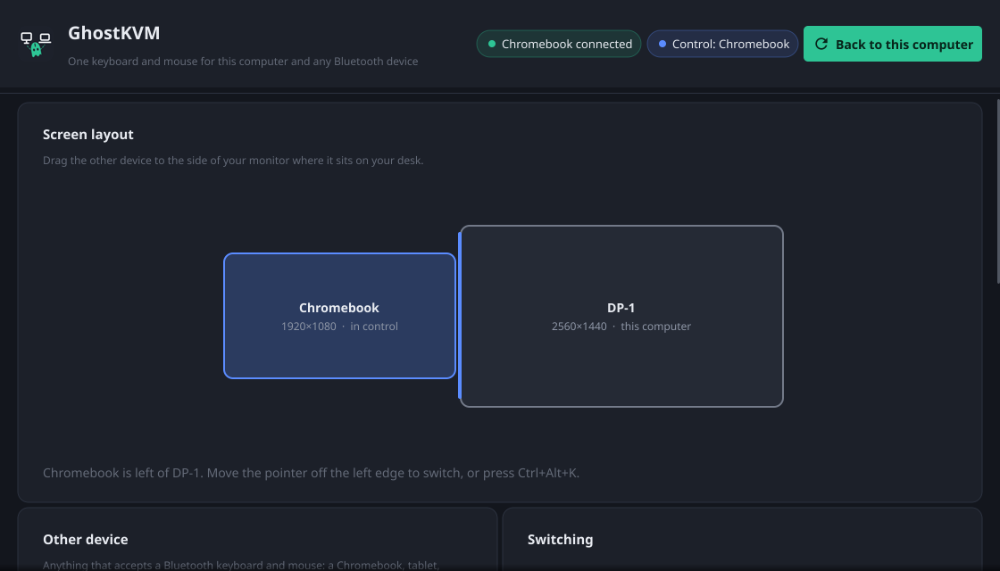
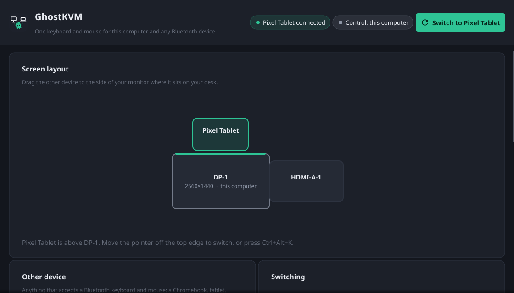
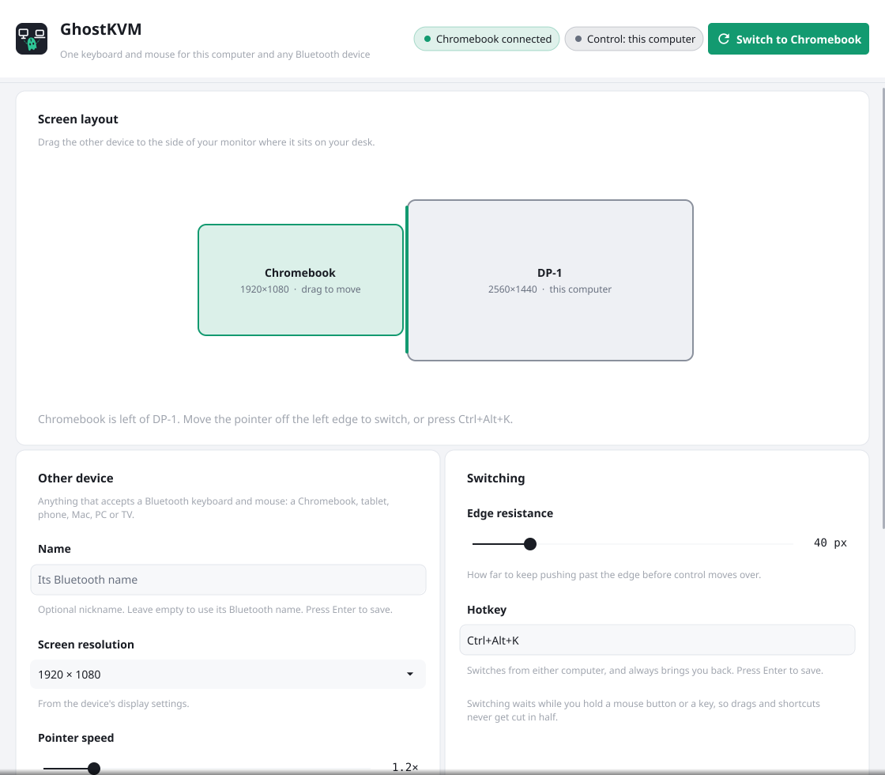

<p align="center">
  
</p>

<h1 align="center">GhostKVM</h1>

<p align="center">
  One keyboard and mouse for your Linux desktop <b>and</b> your Chromebook, tablet, phone or any other Bluetooth device.<br>
  Push the pointer off the edge of your screen and keep working on the other device, like an extra display.
</p>

<p align="center">
  <a href="https://highercomve.github.io/GhostKVM/"><b>Website</b></a> ·
  <a href="#install">Install</a> ·
  <a href="#getting-started">Getting started</a> ·
  <a href="#troubleshooting">Troubleshooting</a>
</p>

<p align="center">
  <a href="LICENSE.md"></a>
  
  
  <a href="https://github.com/highercomve/GhostKVM/releases/latest"></a>
</p>

---

<p align="center">
  
</p>

<table>
  <tr>
    <td width="33%"></td>
    <td width="33%"></td>
    <td width="33%"></td>
  </tr>
  <tr>
    <td align="center"><sub>Chromebook in control</sub></td>
    <td align="center"><sub>Any side of any monitor</sub></td>
    <td align="center"><sub>Follows light and dark mode</sub></td>
  </tr>
</table>

## Why GhostKVM

Software KVMs such as Input Leap, Deskflow or Lan Mouse need a helper app on every
computer. ChromeOS cannot run one: apps there are not allowed to read or produce
input for the whole system.

GhostKVM needs **nothing on the Chromebook**. Your Linux desktop pretends to be a
**Bluetooth keyboard and mouse**, so the Chromebook pairs with it like with any other
wireless keyboard. That also means it works with **anything that accepts a Bluetooth
keyboard and mouse**: Android tablets and phones, iPads, Macs, Windows PCs, TVs. The
Chromebook is used as the example below. When your pointer leaves the desktop's screen, GhostKVM captures
your real keyboard and mouse and sends them over that Bluetooth link instead.

```
 Linux desktop                                     Chromebook
┌───────────────────────────────┐               ┌────────────────────┐
│  your keyboard + mouse        │               │                    │
│        │                      │   Bluetooth   │  sees a normal     │
│        ▼                      │   Low Energy  │  wireless keyboard │
│  GhostKVM ── pointer at edge? ├──────────────▶│  and mouse         │
│        │        no            │   (HID over   │                    │
│        ▼                      │    GATT)      │                    │
│  your desktop as usual        │               │                    │
└───────────────────────────────┘               └────────────────────┘
```

## Features

- **Works like an extra display.** Place the Chromebook to the left, right, top or bottom
  of any monitor. Cross that edge and the pointer appears on the Chromebook at the same
  height; cross back and it returns.
- **Nothing to install on the other device.** It is a standard Bluetooth keyboard and mouse,
  so it works with a Chromebook, tablet, phone, Mac, PC or TV. GhostKVM shows the device by
  its own Bluetooth name.
- **Keeps your other Bluetooth devices.** One adapter talks to your Bluetooth mouse and to
  the Chromebook at the same time.
- **Hotkey** (`Ctrl+Alt+K` by default) switches from either computer and always brings
  you back.
- **Safe switching.** It never switches in the middle of a drag or while a key is held, so
  nothing gets stuck. If the Chromebook disconnects, or GhostKVM stops for any reason,
  your keyboard and mouse go straight back to the desktop.
- **Tray app.** Close the window and GhostKVM keeps running in your panel; the icon shows
  the link state at a glance.
- **Single binary**, with the config in one small TOML file.

<p align="center">
  
</p>

## Requirements

| | |
|---|---|
| **Desktop** | Any Linux desktop. See [Desktops](#desktops) for which ones switch at the screen edge |
| **Bluetooth** | BlueZ 5.x and an adapter that supports the LE peripheral role (most from the last few years do; tested with an Intel AX210) |
| **Permissions** | Your user in the `input` group, to read keyboards and mice. No root needed. |
| **Other computer** | A Chromebook, or anything else that accepts a Bluetooth LE keyboard and mouse |
| **Building** (only from source) | Go 1.26+, a C compiler, and the OpenGL/X11 headers Fyne needs (`libgl`, `libx11`, `libxcursor`, `libxrandr`, `libxinerama`, `libxi`, `libxxf86vm`, `libwayland`, `libxkbcommon`) |

### Desktops

| Desktop | Switch to the Chromebook | Come back |
|---|---|---|
| **Hyprland** | Push past the screen edge, hotkey or tray | Push past the Chromebook's edge, or the hotkey |
| **X11 sessions:** GNOME or KDE on Xorg, XFCE, Cinnamon, MATE, i3… | Push past the screen edge, hotkey or tray | Push past the Chromebook's edge, or the hotkey |
| **Wayland with the InputCapture portal:** GNOME 45+, KDE Plasma 6.1+ | Push past the screen edge, hotkey or tray | Push past the Chromebook's edge, or the hotkey |
| **Other Wayland desktops:** Sway, older GNOME or KDE… | Hotkey or tray | Push past the Chromebook's edge, or the hotkey |

Wayland doesn't let apps follow the pointer, so on GNOME and KDE GhostKVM asks the
desktop, through the XDG **InputCapture portal**, to put a barrier on the Chromebook's
edge and tell it when you cross. The first time, the desktop asks you to allow it; where
the portal supports it, that permission is remembered. The edge must be an outer edge
of your screens. Set `screen_backend` (`auto`, `hyprland`, `x11`, `portal`, `none`) to
force a choice.

## Install

Download the latest release for x86_64 or aarch64 from
**[Releases](https://github.com/highercomve/GhostKVM/releases/latest)**:

| File | For | Updates |
|---|---|---|
| `ghostkvm-linux-<arch>.tar.xz` | any distribution | **updates itself** |
| `ghostkvm_<version>_<arch>.deb` | Debian, Ubuntu, Pop!_OS… | through your package manager |
| `ghostkvm-<version>.<arch>.rpm` | Fedora, openSUSE… | through your package manager |
| `ghostkvm-<version>-<arch>.pkg.tar.zst` | Arch, Manjaro… | through your package manager |

With the tarball:

```bash
tar -xJf ghostkvm-linux-x86_64.tar.xz
install -Dm755 ghostkvm-linux-x86_64/bin/ghostkvm ~/.local/bin/ghostkvm
```

Or build from source (`make install-local` also adds a launcher entry and icon):

```bash
git clone https://github.com/highercomve/GhostKVM.git
cd GhostKVM
make install-local
```

### Updates

GhostKVM checks for a new release once a day. When one is out, an **Update** button
appears in the window and the tray: it downloads the release, checks its signature
against the key built into GhostKVM, replaces itself and restarts. Copies installed from
a `.deb`, `.rpm` or Arch package are updated by your package manager instead.
Development builds never update themselves.

Make sure your user can read input devices:

```bash
groups | grep -q input || sudo usermod -aG input "$USER"   # then log out and back in
```

## Getting started

1. **Start GhostKVM** from your launcher, or run `ghostkvm`. The ghost appears in your tray.
2. **Pair the Chromebook.** On it, open **Settings › Bluetooth › Pair new device** and pick
   **GhostKVM**. Accept the code if one is shown. This is needed only once: afterwards it
   reconnects by itself whenever GhostKVM is running.
3. **Place it.** In the GhostKVM window, drag the Chromebook to the side of your monitor
   where it sits on your desk, and pick its screen resolution.
4. **Move the pointer off that edge** (or press `Ctrl+Alt+K` on desktops without edge
   switching). You are now on the Chromebook. Come back by pushing past its edge, or press
   `Ctrl+Alt+K`.

> [!TIP]
> On the Chromebook, turn off **Settings › Device › Mouse › Mouse acceleration**. GhostKVM
> keeps track of where the Chromebook's pointer is, and acceleration makes that drift.
> Use **Pointer speed** in GhostKVM to set how fast it moves instead.

### Run it at login

Most desktops start apps listed in `~/.config/autostart`:

```bash
mkdir -p ~/.config/autostart
cp ~/.local/share/applications/ghostkvm.desktop ~/.config/autostart/   # or /usr/share/applications/ from a package
```

On Hyprland, add it to your config instead:

```lua
-- ~/.config/hypr/hyprland.lua
hl.on("hyprland.start", function()
    hl.exec_cmd("ghostkvm")
end)
```

`ghostkvm -headless` runs without the window and tray, for example from a systemd user
service.

## Drive the Chromebook from scripts

`ghostkvm ctl` sends keys and mouse actions to the Chromebook through the running
GhostKVM, while your own keyboard and mouse stay on the desktop. Use it from scripts or
automation tools such as desktopctrl and AI agents.

```bash
ghostkvm ctl status                 # connected? who has control?
ghostkvm ctl key search             # open the ChromeOS launcher
ghostkvm ctl type "chrome://settings"
ghostkvm ctl key Return
ghostkvm ctl moveto 960 540         # absolute, in Chromebook pixels
ghostkvm ctl click                  # also: doubleclick, scroll -3, move 40 0
ghostkvm ctl switch peer            # give your keyboard and mouse to the Chromebook
```

The control socket lives at `$XDG_RUNTIME_DIR/ghostkvm/ctl.sock` and only your user can
open it. Commands are sent blind: Bluetooth carries input to the Chromebook, not its
screen back. `type` assumes the Chromebook uses a US keyboard layout, and `moveto` needs
its mouse acceleration off.

## Configuration

Everything in the window is saved to `~/.config/ghostkvm/config.toml`, which you can also
edit by hand (restart GhostKVM afterwards):

```toml
bluetooth_name = "GhostKVM"     # name the Chromebook sees when pairing
hotkey = "Ctrl+Alt+K"           # switch from either computer
edge_push = 40.0                # pixels to keep pushing past the edge before switching
ignore = ["ydotoold", "YubiKey"] # input devices never sent to the Chromebook (name contains)

[peer]
  name = "chromebook"
  side = "left"                 # left | right | top | bottom
  monitor = "DP-1"              # desktop monitor it sits next to (see `hyprctl monitors`)
  width = 1920.0                # Chromebook screen resolution
  height = 1080.0
  speed = 1.0                   # pointer speed on the Chromebook
```

## Troubleshooting

**The Chromebook does not list GhostKVM.** The desktop must not be discoverable as a normal
Bluetooth computer at the same time, or the Chromebook merges the two and shows only the
computer's name. GhostKVM turns that off while it runs. If you made the desktop discoverable
in another app, turn it off there, then switch the Chromebook's Bluetooth off and on.

**The pointer lags behind and then jumps.** Bluetooth LE delivers a limited number of
updates per second. GhostKVM sends one combined update every 15 ms to stay within that; if
it still lags, move the Chromebook closer or reduce other Bluetooth traffic on the desktop.

**The pointer lands at the wrong height, or crossing back needs extra pushing.** Check that
the resolution in GhostKVM matches the Chromebook's, and that mouse acceleration is off on it.

**Something feels stuck.** Press `Ctrl+Alt+K`. Quitting GhostKVM from the tray always hands
the keyboard and mouse back to the desktop.

> [!NOTE]
> Do not enable `Privacy = device` in `/etc/bluetooth/main.conf` for GhostKVM: it changes
> the adapter's address, and Bluetooth devices you already paired may refuse to reconnect.

## How it works

| Part | What it does |
|---|---|
| [`internal/blehid`](internal/blehid) | Registers a HID-over-GATT service and advertisement with BlueZ over D-Bus, so the adapter appears as a BLE keyboard and mouse |
| [`internal/evdev`](internal/evdev) | Reads `/dev/input` devices and grabs them exclusively while the Chromebook has control, so the desktop stops reacting |
| [`internal/screen`](internal/screen) | The desktop side: monitors, cursor position, moving and hiding the cursor, with backends for Hyprland, X11, the Wayland InputCapture portal (with a small pure-Go EI client) and a hotkey-only fallback |
| [`internal/ctl`](internal/ctl) | The control socket and `ghostkvm ctl` |
| [`internal/update`](internal/update) | The signed self-updater; [`tools/updater`](tools/updater) signs releases |
| [`internal/kvm`](internal/kvm) | The switching state machine: edge detection, tracking the Chromebook's pointer, forwarding keys and motion |
| [`internal/gui`](internal/gui) | The Fyne window and tray icon |
| [`cmd/ghostkvm-bletest`](cmd/ghostkvm-bletest) | A small static test that only advertises the keyboard and mouse and moves the remote pointer in a square |

ChromeOS never reports where its pointer is, so on entering GhostKVM pins it against the
edge it comes in from and then tracks every movement it sends.

## Development

```bash
make build     # bin/ghostkvm
make run       # build and start
make vet       # go vet ./...
make test      # go test ./... (the X11 test uses Xvfb when installed)
make icons     # re-render the PNG icons from assets/*.svg (needs rsvg-convert)
make screenshots   # re-render docs/images/app*.png from the real UI with sample data
cd site && hugo server   # preview the website at http://localhost:1313/GhostKVM/
make bletest   # bin/ghostkvm-bletest, a static binary for testing an adapter
make release-tarball packages   # what CI builds: the .tar.xz plus .deb, .rpm and Arch packages
```

### Releasing

Add a `## vX.Y.Z` section to [CHANGELOG.md](CHANGELOG.md), then tag and push:

```bash
git tag v0.1.0 && git push origin v0.1.0
```

The [release workflow](.github/workflows/release.yml) builds x86_64 and aarch64, signs the
update bundles with the `UPDATER_PRIVATE_KEY` secret, writes `latest.json` and publishes
the release.

## Roadmap

- Clipboard sharing between the desktop and the Chromebook
- Media and volume keys
- Windows and macOS on the desktop side, through a small USB dongle (they don't allow acting as a Bluetooth keyboard)

## License

GhostKVM is **source-available for non-commercial use** under the
[PolyForm Noncommercial License 1.0.0](LICENSE.md). You may use, change and share it for
personal, educational, research and other non-commercial purposes. Commercial use is not
permitted.
