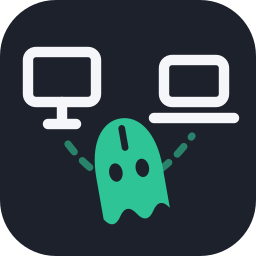
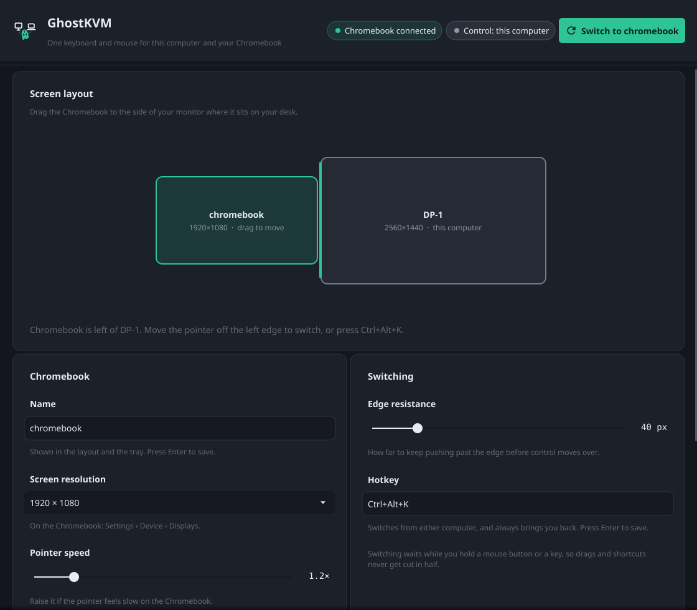

<p align="center">
  
</p>

<h1 align="center">GhostKVM</h1>

<p align="center">
  One keyboard and mouse for your Linux desktop <b>and</b> your Chromebook.<br>
  Push the pointer off the edge of your screen and keep working on the Chromebook, like an extra display.
</p>

<p align="center">
  <a href="https://highercomve.github.io/GhostKVM/"><b>Website</b></a> ·
  <a href="#install">Install</a> ·
  <a href="#getting-started">Getting started</a> ·
  <a href="#troubleshooting">Troubleshooting</a>
</p>

<p align="center">
  <a href="LICENSE.md"></a>
  
  
</p>

---

<p align="center">
  
</p>

## Why GhostKVM

Software KVMs such as Input Leap, Deskflow or Lan Mouse need a helper app on every
computer. ChromeOS cannot run one: apps there are not allowed to read or produce
input for the whole system.

GhostKVM needs **nothing on the Chromebook**. Your Linux desktop pretends to be a
**Bluetooth keyboard and mouse**, so the Chromebook pairs with it like with any other
wireless keyboard. When your pointer leaves the desktop's screen, GhostKVM captures
your real keyboard and mouse and sends them over that Bluetooth link instead.

```
 Linux desktop (Hyprland)                          Chromebook
┌───────────────────────────────┐               ┌────────────────────┐
│  your keyboard + mouse        │               │                    │
│        │                      │   Bluetooth   │  sees a normal     │
│        ▼                      │   Low Energy  │  wireless keyboard │
│  GhostKVM ── pointer at edge? ├──────────────▶│  and mouse         │
│        │        no            │   (HID over   │                    │
│        ▼                      │    GATT)      │                    │
│  Hyprland as usual            │               │                    │
└───────────────────────────────┘               └────────────────────┘
```

## Features

- **Works like an extra display.** Place the Chromebook to the left, right, top or bottom
  of any monitor. Cross that edge and the pointer appears on the Chromebook at the same
  height; cross back and it returns.
- **Nothing to install on the Chromebook.** It is a standard Bluetooth keyboard and mouse.
- **Keeps your other Bluetooth devices.** One adapter talks to your Bluetooth mouse and to
  the Chromebook at the same time.
- **Hotkey** (`Ctrl+Alt+K` by default) switches from either computer and always brings
  you back.
- **Safe switching.** It never switches in the middle of a drag or while a key is held, so
  nothing gets stuck. If the Chromebook disconnects, or GhostKVM stops for any reason,
  your keyboard and mouse go straight back to the desktop.
- **Tray app.** Close the window and GhostKVM keeps running in your panel; the icon shows
  the link state at a glance.
- **Single binary**, with the config in one small TOML file.

<p align="center">
  
</p>

## Requirements

| | |
|---|---|
| **Desktop** | Linux with [Hyprland](https://hyprland.org) 0.55 or newer (uses its Lua IPC) |
| **Bluetooth** | BlueZ 5.x and an adapter that supports the LE peripheral role (most from the last few years do; tested with an Intel AX210) |
| **Permissions** | Your user in the `input` group, to read keyboards and mice. No root needed. |
| **Other computer** | A Chromebook, or anything else that accepts a Bluetooth LE keyboard and mouse |
| **Building** | Go 1.25+, a C compiler, and the OpenGL/X11 headers Fyne needs (`libgl`, `libx11`, `libxcursor`, `libxrandr`, `libxinerama`, `libxi`, `libxxf86vm`) |

## Install

```bash
git clone https://github.com/highercomve/GhostKVM.git
cd GhostKVM
make install-local   # builds, installs to ~/.local/bin, adds a launcher entry and icon
```

Or install only the binary:

```bash
go install github.com/highercomve/GhostKVM/cmd/ghostkvm@latest
```

Make sure your user can read input devices:

```bash
groups | grep -q input || sudo usermod -aG input "$USER"   # then log out and back in
```

## Getting started

1. **Start GhostKVM** from your launcher, or run `ghostkvm`. The ghost appears in your tray.
2. **Pair the Chromebook.** On it, open **Settings › Bluetooth › Pair new device** and pick
   **GhostKVM**. Accept the code if one is shown. This is needed only once: afterwards it
   reconnects by itself whenever GhostKVM is running.
3. **Place it.** In the GhostKVM window, drag the Chromebook to the side of your monitor
   where it sits on your desk, and pick its screen resolution.
4. **Move the pointer off that edge.** You are now on the Chromebook. Come back the same
   way, or press `Ctrl+Alt+K`.

> [!TIP]
> On the Chromebook, turn off **Settings › Device › Mouse › Mouse acceleration**. GhostKVM
> keeps track of where the Chromebook's pointer is, and acceleration makes that drift.
> Use **Pointer speed** in GhostKVM to set how fast it moves instead.

### Run it at login

Add it to your Hyprland config so the tray icon is always there:

```lua
-- ~/.config/hypr/hyprland.lua
hl.on("hyprland.start", function()
    hl.exec_cmd("ghostkvm")
end)
```

`ghostkvm -headless` runs without the window and tray, for example from a systemd user
service.

## Configuration

Everything in the window is saved to `~/.config/ghostkvm/config.toml`, which you can also
edit by hand (restart GhostKVM afterwards):

```toml
bluetooth_name = "GhostKVM"     # name the Chromebook sees when pairing
hotkey = "Ctrl+Alt+K"           # switch from either computer
edge_push = 40.0                # pixels to keep pushing past the edge before switching
ignore = ["ydotoold", "YubiKey"] # input devices never sent to the Chromebook (name contains)

[peer]
  name = "chromebook"
  side = "left"                 # left | right | top | bottom
  monitor = "DP-1"              # desktop monitor it sits next to (see `hyprctl monitors`)
  width = 1920.0                # Chromebook screen resolution
  height = 1080.0
  speed = 1.0                   # pointer speed on the Chromebook
```

## Troubleshooting

**The Chromebook does not list GhostKVM.** The desktop must not be discoverable as a normal
Bluetooth computer at the same time, or the Chromebook merges the two and shows only the
computer's name. GhostKVM turns that off while it runs. If you made the desktop discoverable
in another app, turn it off there, then switch the Chromebook's Bluetooth off and on.

**The pointer lags behind and then jumps.** Bluetooth LE delivers a limited number of
updates per second. GhostKVM sends one combined update every 15 ms to stay within that; if
it still lags, move the Chromebook closer or reduce other Bluetooth traffic on the desktop.

**The pointer lands at the wrong height, or crossing back needs extra pushing.** Check that
the resolution in GhostKVM matches the Chromebook's, and that mouse acceleration is off on it.

**Something feels stuck.** Press `Ctrl+Alt+K`. Quitting GhostKVM from the tray always hands
the keyboard and mouse back to the desktop.

> [!NOTE]
> Do not enable `Privacy = device` in `/etc/bluetooth/main.conf` for GhostKVM: it changes
> the adapter's address, and Bluetooth devices you already paired may refuse to reconnect.

## How it works

| Part | What it does |
|---|---|
| [`internal/blehid`](internal/blehid) | Registers a HID-over-GATT service and advertisement with BlueZ over D-Bus, so the adapter appears as a BLE keyboard and mouse |
| [`internal/evdev`](internal/evdev) | Reads `/dev/input` devices and grabs them exclusively while the Chromebook has control, so Hyprland stops reacting |
| [`internal/hypr`](internal/hypr) | Talks to Hyprland's IPC socket: monitors, cursor position, moving and hiding the cursor |
| [`internal/kvm`](internal/kvm) | The switching state machine: edge detection, tracking the Chromebook's pointer, forwarding keys and motion |
| [`internal/gui`](internal/gui) | The Fyne window and tray icon |
| [`cmd/ghostkvm-bletest`](cmd/ghostkvm-bletest) | A small static test that only advertises the keyboard and mouse and moves the remote pointer in a square |

ChromeOS never reports where its pointer is, so on entering GhostKVM pins it against the
edge it comes in from and then tracks every movement it sends.

## Development

```bash
make build     # bin/ghostkvm
make run       # build and start
make vet       # go vet ./...
make icons     # re-render the PNG icons from assets/*.svg (needs rsvg-convert)
cd site && hugo server   # preview the website at http://localhost:1313/GhostKVM/
make bletest   # bin/ghostkvm-bletest, a static binary for testing an adapter
```

## Roadmap

- Clipboard sharing between the desktop and the Chromebook
- Media and volume keys
- Desktops other than Hyprland

## License

GhostKVM is **source-available for non-commercial use** under the
[PolyForm Noncommercial License 1.0.0](LICENSE.md). You may use, change and share it for
personal, educational, research and other non-commercial purposes. Commercial use is not
permitted.
